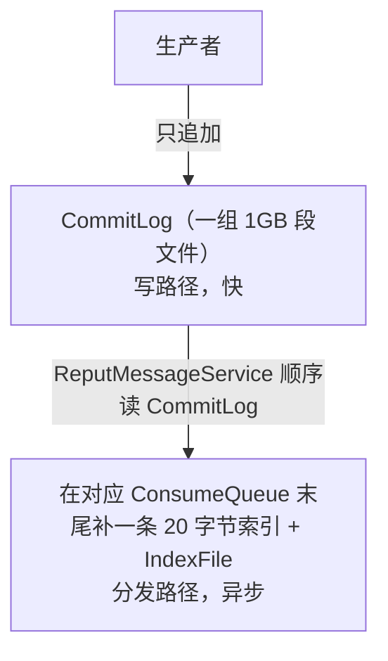

# 一、现象

`mqadmin consumerProgress` 显示的 **Diff Total 持续增长**，但集群里**看不到任何生产者**，`clusterList` 的 `InTPS=0`，消费者也没有在线。直觉上"没有生产者就不会有新消息"，Diff 为什么还在涨？

先说结论：**这不是新消息，而是 Broker 正在把 CommitLog 里"已写入但还没建索引"的存量消息，通过 Reput 线程补写进 ConsumeQueue（dispatch 追赶）。每补一条索引，ConsumeQueue 的 maxOffset 就前进一格，而 `consumerProgress` 里的 `#Broker Offset` 就是这个 maxOffset，于是 Diff 持续变大。**

# 二、环境

- RocketMQ 5.3.0，controller 模式（nameserver 内嵌 controller）
- 2 组 broker（broker-a / broker-b，各含从节点），共 4 节点
- 观察对象：topic `BenchmarkTest`，消费组 `benchmark_consumer`

# 三、排查过程

## 步骤 1：确认积压确实在增长

```
mqadmin consumerProgress -n 127.0.0.1:9857 -g benchmark_consumer
```

输出（截取）：

```
#Topic            #Broker Name  #QID  #Broker Offset  #Consumer Offset  #Diff  #Inflight  #LastTime
BenchmarkTest     broker-a      0     7608            6657              951    0          2026-09-09 19:03:15
BenchmarkTest     broker-a      1     7608            6657              951    0          2026-09-09 19:03:15
BenchmarkTest     broker-a      2     7608            6657              951    0          2026-09-09 19:03:15
...
Consume TPS: 0.00
Consume Diff Total: 1814434
Consume Inflight Total: 0
```

注意两点：

- `#Consumer Offset` 对应的 `#LastTime` 停在 **2026-09-09**，说明该组很久没有消费者提交位点了；
- `Consume TPS: 0.00`、`Inflight 0`。

间隔约 55 秒再采一次，做对比：

| 时间 | BrokerOffset 之和 | ConsumerOffset 之和 | Diff Total | dispatch_behind[broker-a] | dispatch_behind[broker-b] |
|---|---|---|---|---|---|
| 17:26:16 | 34,657,813 | 32,843,379 | **1,814,434** | 5.989437642e9 | 6.002279778e9 |
| 17:27:11 | 34,677,134 | 32,843,379 | **1,833,755** | 5.985534070e9 | 5.999172352e9 |
| Δ | **+19,321** | **0** | **+19,321** | **−3.90 MB** | **−3.11 MB** |

**Diff 的增长完全来自 Broker Offset 的增长，Consumer Offset 一动不动。**

## 步骤 2：确认没有生产者

```
# 1) 本机没有任何生产/消费进程
ps -eo pid,args | grep -E 'benchmark.(Producer|Consumer)|DefaultMQ(Producer|PushConsumer)' | grep -v grep
# (none)

# 2) broker 上的“生产者连接数”指标为 0
curl -s http://127.0.0.1:5557/metrics  | grep -c '^rocketmq_producer_connections'   # 0
curl -s http://127.0.0.1:25557/metrics | grep -c '^rocketmq_producer_connections'   # 0

# 3) 集群列表 InTPS 全为 0.00
mqadmin clusterList -n 127.0.0.1:9856
# #Cluster Name   #Broker Name  #BID  #Addr             #Version  #InTPS(LOAD) ...
# DefaultCluster  broker-a      0     127.0.0.1:30900   V5_3_0   0.00(0,0ms)  ...
# DefaultCluster  broker-b      0     127.0.0.1:30920   V5_3_0   0.00(0,0ms)  ...

# 4) 看 broker 端口上的连接，只有监控 daemon 与 broker 自身 HA，没有外部生产者
ss -tnp | grep -E ':30900|:30920'
# java pid=347896   (监控 daemon)
# java pid=384178   (broker HA)
# java pid=384425   (broker HA)
```

## 步骤 3：确认没有在线消费者

```
mqadmin consumerConnection -n 127.0.0.1:9856 -g benchmark_consumer
# Caused by: org.apache.rocketmq.client.exception.MQBrokerException:
#   CODE: 206  DESC: the consumer group[benchmark_consumer] not online BROKER: 127.0.0.1:30900
```

即：**该组没有在线消费者**，`consumerProgress` 里看到的只是它**最后一次提交、持久化在 broker 上的位点**。

## 步骤 4（关键）：对比“生产计数”和“分发落后”

```
# 生产计数（是否真有新消息写入）
curl -s http://127.0.0.1:5557/metrics  | grep 'rocketmq_messages_in_total.*BenchmarkTest'
curl -s http://127.0.0.1:25557/metrics | grep 'rocketmq_messages_in_total.*BenchmarkTest'
# a=1.8265593E7   b=1.8210277E7

# 分发落后（CommitLog 已写 − 已建 ConsumeQueue 索引）
curl -s http://127.0.0.1:5557/metrics  | grep '^rocketmq_storage_dispatch_behind_bytes'
curl -s http://127.0.0.1:25557/metrics | grep '^rocketmq_storage_dispatch_behind_bytes'
# a=5.989437642E9   b=6.002279778E9
```

两次采样结果：

- `rocketmq_messages_in_total`（生产计数）**完全没变** → **没有新消息**；
- `rocketmq_storage_dispatch_behind_bytes`（分发落后）**在下降**（a −3.90 MB、b −3.11 MB）；
- `Broker Offset` 之和 **+19,321**（约 7.01 MB ÷ 19,321 ≈ 363 B/条）。

**offset 增加的“字节量” ≈ dispatch_behind 减少的“字节量”，而生产计数不变。这说明 ConsumeQueue 正在被“补写”，而不是有新消息进来。**

# 四、原理：CommitLog 与 ConsumeQueue

RocketMQ 的存储有两条**异步解耦**的路径：



- **CommitLog**：所有消息按到达顺序顺序追加（一组 1GB 段文件），是消息的**唯一权威存储**（数据本体在这里）。
- **ConsumeQueue**：每个 topic 的每个队列一个定长索引文件，每项 20 字节（`commitlog offset(8) + size(4) + tag hash(8)`），只记“消息在 CommitLog 的哪个位置”，**不存消息体**。消费者先读 ConsumeQueue 拿到位置，再回 CommitLog 读消息体。
- **ReputMessageService（dispatch 线程）**：后台顺序扫描 CommitLog，把每条消息解析成对应队列的 ConsumeQueue 索引，并不断推进 `reputFromOffset`。

**dispatch behind（分发落后）** 的定义：

```
dispatch behind = CommitLog 最大写入位点 − Reput 已分发位点
                = 有多少字节的 CommitLog 还没建成 ConsumeQueue 索引
```

`consumerProgress` 里的 **`#Broker Offset` 就是 ConsumeQueue 的 maxOffset**。只要 Reput 还在补索引，maxOffset 就持续增大；由于没有消费者提交，`Diff = Broker Offset − Consumer Offset` 就持续增大。

**一句话类比**：CommitLog 是流水账原文，ConsumeQueue 是按主题分好的目录。生产者只写原文，后台异步“编目录”。生产者停了但目录还没编完，页码（Broker Offset）就还在涨——那不是新故事，是在补目录。

分发落后（`rocketmq_storage_dispatch_behind_bytes`）正常应接近 0；持续很大说明“写路径”明显快于“分发路径”或分发被拖住。常见原因：写入瞬时高峰、磁盘 IO 慢、ReputMessageService 受阻、broker 重启后追赶存量、队列过多。

# 五、结论与建议

1. **Diff 增长 ≠ 有新生产**。判断有无生产要看 `rocketmq_messages_in_total`（是否增长）和 `rocketmq_producer_connections`（是否为 0）。
2. 本例是 **broker 重启后存在约 6 GB 未分发存量，Reput 正在补索引**。等 `dispatch_behind → 0`，Broker Offset 停止增长，Diff 也随之停止增长（此后有消费者提交 offset 才会下降）。
3. **注意追赶速度**：本例约 350 条/s（≈127 KB/s）偏慢，正常 reput 可达每秒数万条。若长期追不上，建议排查：
   - 磁盘 IO：`iostat -x 1` 看 commitlog/consumequeue 所在盘的 `await`/`util`；
   - broker JVM/GC、CPU；
   - 队列数过多（本例每 broker 1024 队列，分发压力大）；
   - broker 日志是否有 ConsumeQueue 重建、慢 IO 的迹象。

# 六、附：一键复现排查

```
NS=127.0.0.1:9856
GROUP=benchmark_consumer
METRIC=http://127.0.0.1:5557/metrics

# 1. 积压是否增长
mqadmin consumerProgress -n "$NS" -g "$GROUP" | tail -3

# 2. 是否有生产
mqadmin clusterList -n "$NS" | awk 'NR==1 || /DefaultCluster/'
curl -s "$METRIC" | grep '^rocketmq_producer_connections'
curl -s "$METRIC" | grep 'rocketmq_messages_in_total.*BenchmarkTest'

# 3. 是否在补索引
curl -s "$METRIC" | grep '^rocketmq_storage_dispatch_behind_bytes'

# 4. 消费者是否在线
mqadmin consumerConnection -n "$NS" -g "$GROUP"
```
