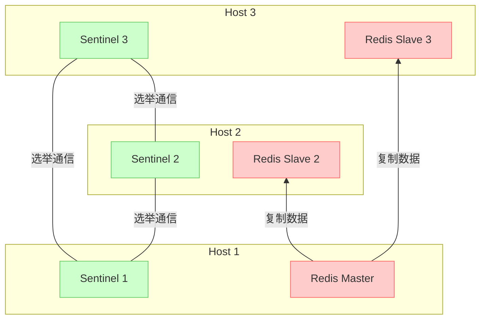
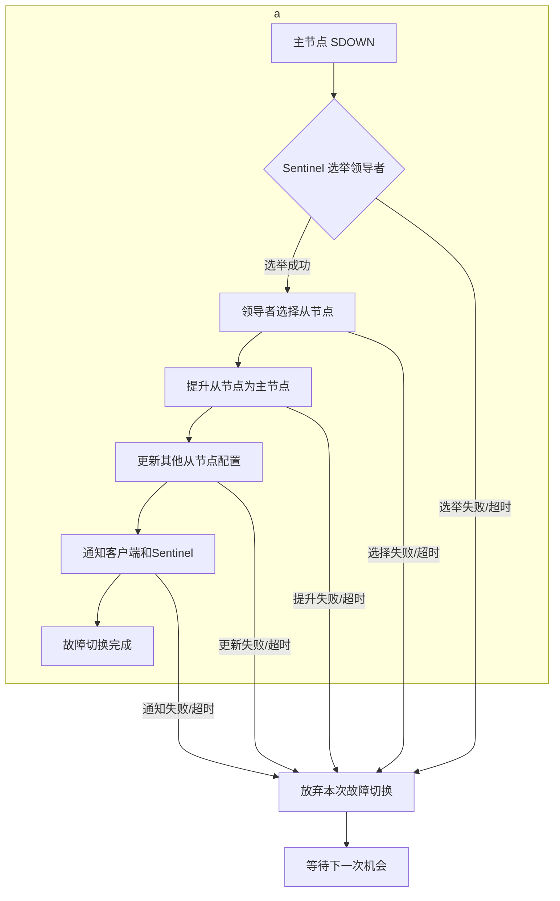

# 一、Redis哨兵模式架构





# 二、节点组件之间的通信机制
## 哨兵监控redis实例（6380）
#### 主观下线
哨兵定期发送ping请求探测所有redis实例，在down-after-milliseconds的时间内哨兵ping探测均失败，哨兵认为redis实例进行主观下线（SDOWN）状态。
#### 客观下线
   当quorum个哨兵都判定master节点主观下线时，master节点进入客观下线状态（ODOWN）。
   
%% 只有master节点有ODOWN状态，哨兵实例，master节点和slave节点都有SDOWN状态 %% 
## 哨兵之间信息同步（redis channel）
#### 通过redis实例的__sentinel__:hello channel同步信息
   哨兵向所有redis实例的__sentinel__:hello channel广播信息（默认每2s），哨兵从每个redis实例订阅信息。哨兵通过这种方式检查其他哨兵的存活状态和交换信息。
```
127.0.0.1:6380> subscribe __sentinel__:hello
1) "message"
2) "__sentinel__:hello"
3) "127.0.0.1,26380,c87752816f175a9c129e68ca6c85b703cf4910cd,28,mymaster,127.0.0.1,6382,28"
   
[sentinel-ip],[sentinel-port],[sentinel-runid],[config-epoch],[master-name],[master-ip],[master-port],[master-config]

```
#### 通过哨兵实例的__sentinel__:hello channel同步信息

## 哨兵选举（16380）
   当master节点进入ODOWN状态后，所有哨兵节点中投票选举一个leader 哨兵，leader 哨兵进行选择新的master节点，并进行主从切换
## redis实例主从复制（6380）
从节点连接到主节点进行数据同步。

# 三、哨兵failover的过程

1. Master 主观下线
   当一个哨兵检测到master节点失败后，哨兵认为master节点主观下线，之后通过sentinel is-master-down-by-addr询问其他哨兵视角该主节点的状态。
2. Master客观下线（需达到 quorum 数量确认）
   如果quorum个哨兵都认为master节点主观下线了，则master节点进入客观下线状态
3. 选举Leader哨兵（Leader Sentinel）
4. Leader哨兵选则新Master
   - 优先级（slave-priority）
   - 复制偏移量（复制数据最接近原 Master 的从节点）
5. 主从切换

6. 新的主节点同步
   reconfigurations，rewrite
7. 客户端通过哨兵获取新 Master 地址

# 四、手动failvover
# 五、问题
1. 发生failover之后切换之后，是否需要向新主节点进行全量同步，并发控制、
2. bump epoch是什么（conmfig-epoch,leader-epoch，current-epoch） 
3. 客户端访问哨兵的机制（怎么选取哨兵，master变了客户端怎么快速感知）
4. 源端主库发生切换之后，redis shark还能否正常同步数据？
5. 目的端的操作和offset持久化不是一个原子操作，持久化offset还没成功就发生了宕机、重启等情况，那么再次断点续传拉取上一次的offset数据最后就不一致了。”在数据同步的过程中不可避免的会由于网络等原因导致命令重发，而考虑到 Redis 的部分命令不是幂等操作的，比如 List 数据类型的相关操作（LPUSH 、 RPUSH 等），对此不加限制就有可能会导致数据不一致的问题，这就会导致 **数据重放** 问题。在 Redis 主从同步模型中，其实也会出现这个问题，不过目前社区对此的处理方案是：**主从同步期间，主库不处理从库的执行结果，并且主库不会主动向从库重发数据。**“




# 命令
手动切换：SENTINEL FAILOVER mymaster